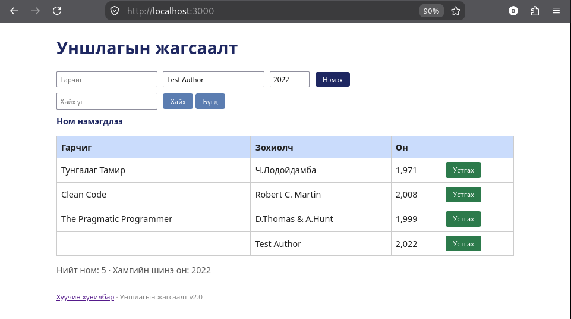
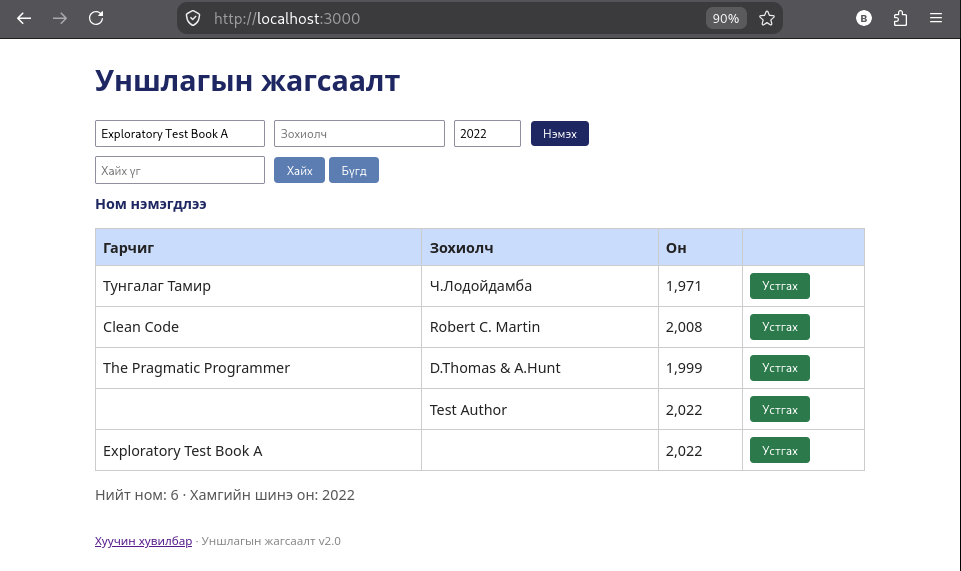
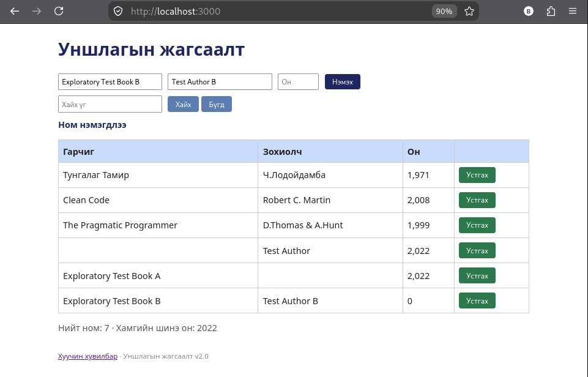

# BUG-01: Шаардлагатай талбар хоосон байхад ном нэмэгдэж байна

**Орчин:** Уншлагын жагсаалт v2.0, Firefox, Linux, 2026-10-20  
**Урьдчилсан нөхцөл:** `node app.js` командаар аппыг шинээр асаасан, эхний 3 ном жагсаалтад байгаа.

## Дахин гаргах алхам

1. `http://localhost:3000/` хаягаар нэвтэрнэ.
2. Гарчиг талбарыг хоосон үлдээж, зохиогчид `Test Author`, он дээр `2022` оруулна.
3. `Нэмэх` товчийг дарна.
4. Дараа нь гарчигт `Exploratory Test Book A`, он дээр `2022` оруулж, зохиогчийг хоосон үлдээнэ.
5. `Нэмэх` товчийг дарна.
6. Дараа нь гарчигт `Exploratory Test Book B`, зохиогчид `Test Author B` оруулж, оныг хоосон үлдээнэ.
7. `Нэмэх` товчийг дарж үр дүнг жагсаалтаас шалгана.

## Хүлээгдэж байсан

Гарчиг, зохиогч, он нь шаардлагатай талбарууд тул аль нэг нь хоосон үед ном нэмэгдэхгүй, хэрэглэгчид ойлгомжтой алдааны мэдэгдэл харуулах ёстой.

## Бодит үр дүн

Хоосон гарчигтай ном нэмэгдсэн. Мөн зохиогч хоосон ном нэмэгдсэн. Он хоосон үед ном нэмэгдэж, хүснэгтэд он `0` гэж харагдсан.

## Ноцтой байдал

**Major** — шаардлагатай мэдээлэлгүй, буруу өгөгдөл жагсаалтад бүртгэгдэж байна.

## Хавсралт

- 
- 
- 

**Олдсон аялал:** Шаардлагатай талбаруудын баталгаажуулалтыг шалгах exploratory tour.
