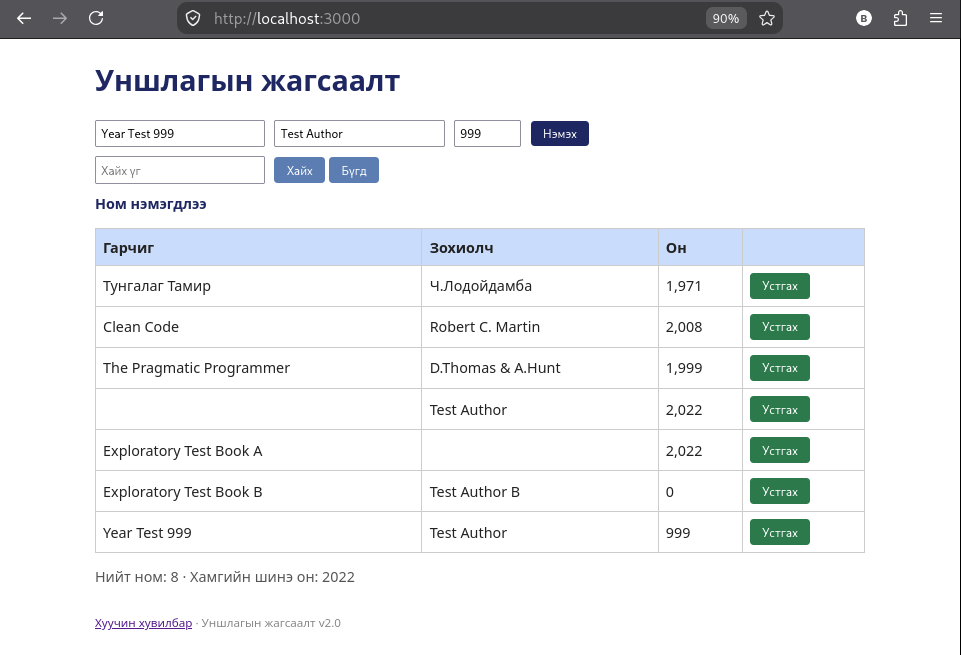
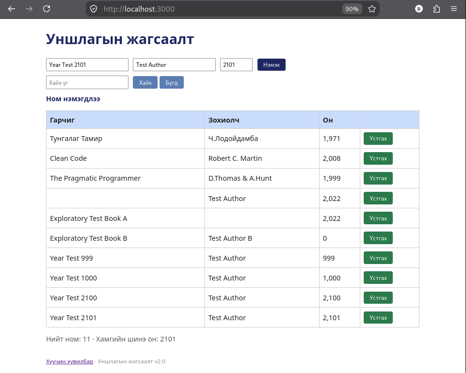
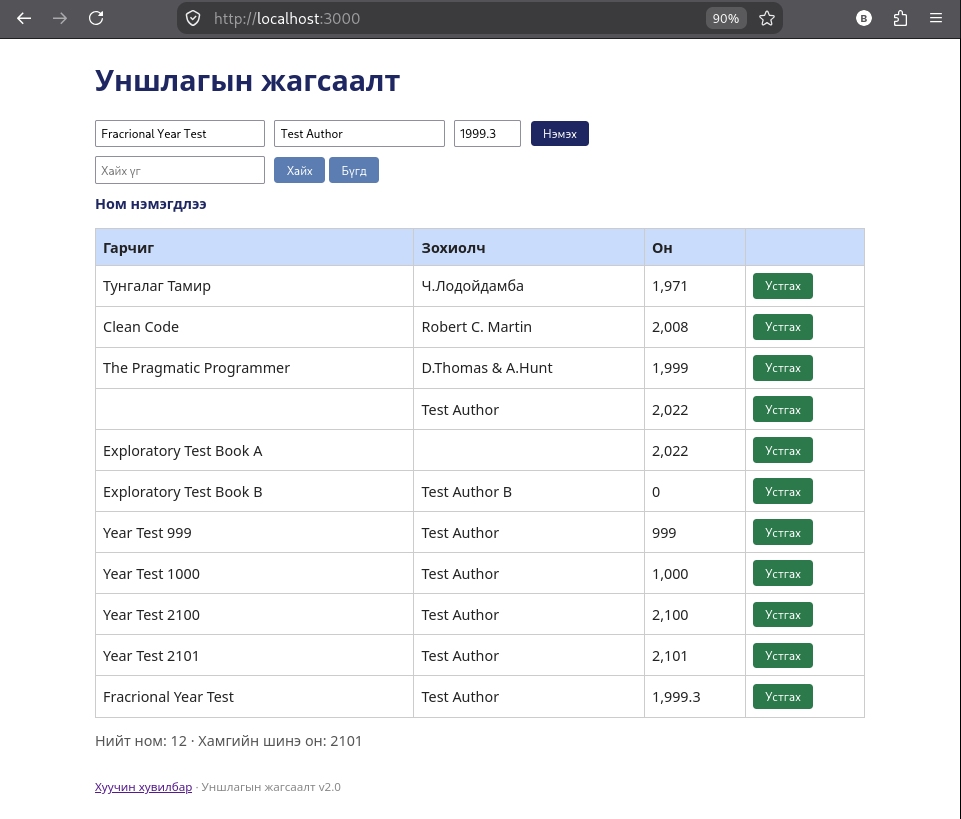

# BUG-02: Номын он зөвшөөрөгдсөн бүхэл тооны хүрээнээс гадуурх утгыг зөвшөөрч байна

**Орчин:** Уншлагын жагсаалт v2.0, Firefox, Linux, 2026-10-20  
**Урьдчилсан нөхцөл:** `node app.js` командаар аппыг шинээр асаасан, эхний 3 ном жагсаалтад байгаа.

## Дахин гаргах алхам

1. `http://localhost:3000/` хаягаар нэвтэрнэ.
2. Гарчигт `Year Test 999`, зохиогчид `Test Author`, он дээр `999` оруулна.
3. `Нэмэх` товчийг дарж ном нэмэгдсэнийг шалгана.
4. Гарчигт `Year Test 2101`, зохиогчид `Test Author`, он дээр `2101` оруулаад нэмнэ.
5. Гарчигт `Fractional Year Test`, зохиогчид `Test Author`, он дээр `1999.3` оруулаад нэмнэ.

## Хүлээгдэж байсан

Он нь 1000–2100 хүртэлх бүхэл тоо байх ёстой. `999`, `2101`, `1999.3` утгуудыг хүлээн авахгүй, алдааны мэдэгдэл харуулах ёстой.

## Бодит үр дүн

`999`, `2101`, `1999.3` утгуудыг оруулахад ном амжилттай нэмэгдсэн. Хүснэгтэд эдгээр утгууд харагдсан.

## Ноцтой байдал

**Major** — өгөгдлийн хүчинтэй байдлын дүрэм зөрчигдөж, буруу онтой ном бүртгэгдэж байна.

## Хавсралт

- 
- 
- 

**Олдсон аялал:** Оны хязгаар болон өгөгдлийн төрлийг шалгах exploratory tour.
