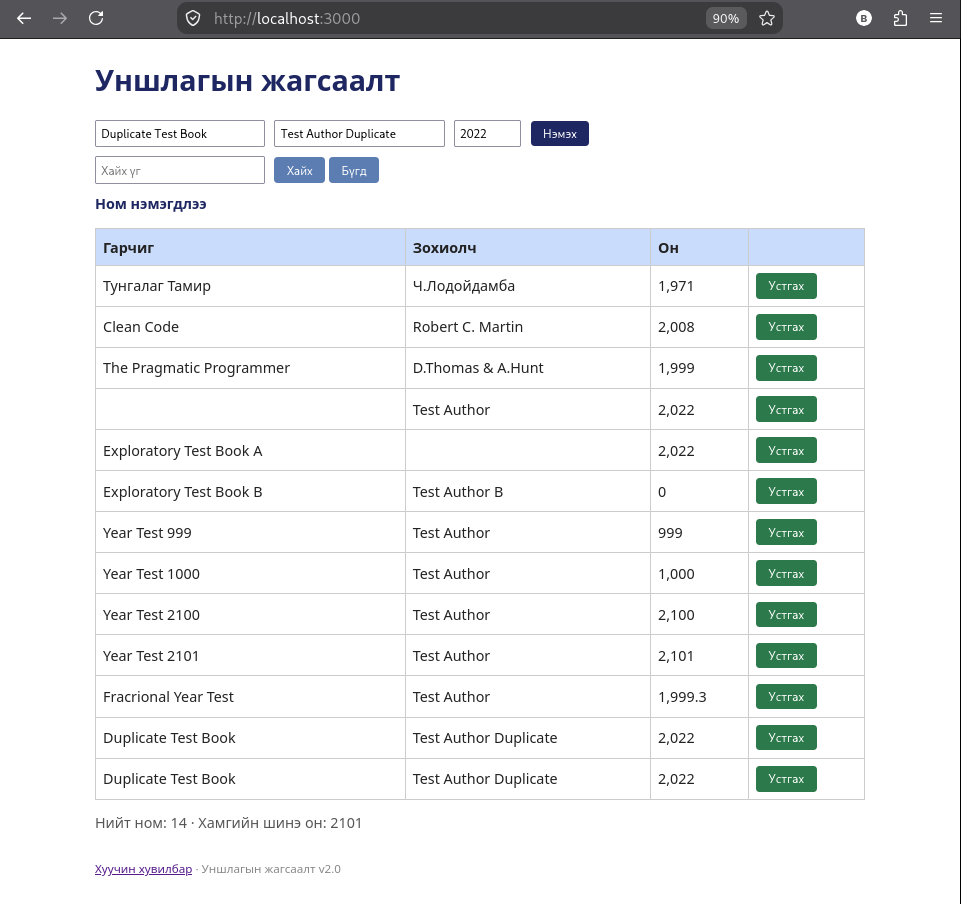

# BUG-03: Ижил гарчиг, зохиогчтой номыг давхар бүртгэх боломжтой

**Орчин:** Уншлагын жагсаалт v2.0, Firefox, Linux, 2026-10-20  
**Урьдчилсан нөхцөл:** `node app.js` командаар аппыг шинээр асаасан, эхний 3 ном жагсаалтад байгаа.

## Дахин гаргах алхам

1. `http://localhost:3000/` хаягаар нэвтэрнэ.
2. Гарчигт `Duplicate Test Book`, зохиогчид `Test Author Duplicate`, он дээр `2022` оруулна.
3. `Нэмэх` товчийг дарна.
4. Ижил гарчиг, зохиогч, оныг дахин оруулна.
5. `Нэмэх` товчийг дахин дарна.
6. Хүснэгтэд ижил мэдээлэлтэй мөр хэд байгааг шалгана.

## Хүлээгдэж байсан

Ижил гарчиг, зохиогчтой номыг давхар бүртгэхгүй байх ёстой. Давхардсан бүртгэл хийх гэж оролдсон үед хэрэглэгчид мэдэгдэл харуулах ёстой.

## Бодит үр дүн

Ижил гарчиг, зохиогч, онтой ном хоёр удаа нэмэгдэж, хүснэгтэд хоёр тусдаа мөр үүссэн.

## Ноцтой байдал

**Major** — номын жагсаалтад давхардсан өгөгдөл үүсгэж байна.

## Хавсралт

**Олдсон аялал:** Давхардсан өгөгдөл бүртгэх боломжийг шалгах exploratory tour.
